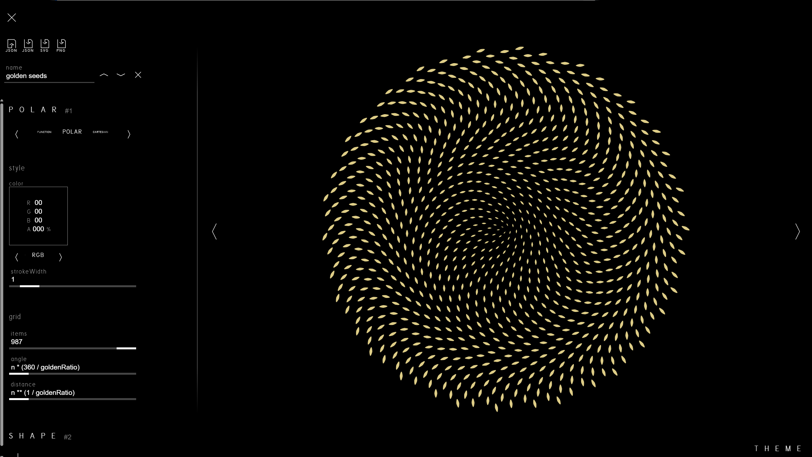

# GoldenSeeds Parametric SVG Generator

[](LICENSE)  
[](https://github.com/RichardLitt/standard-readme)

GoldenSeeds SVG Generator is a web-based application for creating SVG graphics using rule-based mathematical principles (parametric modelling). The application supports various types of graphic generation techniques and allows for saving, exporting, and customizing vector graphics.  
**[Try it yourself](https://tmunz.github.io/GoldenSeeds/)**



## Table of Contents

- [Features](#features)
- [Install](#install)
- [Usage](#usage)
- [Development](#development)
- [Issues](#issues)
- [Contributing](#contributing)
- [License](#license)

## Features

- Rule-based vector graphics creation.
- Multiple graphic generators including:
  - Cartesian or polar grids.
  - Regular shapes.
  - Text, trees, and Voronoi diagrams.
- Ability to combine different generators for complex drawings.
- Save drawings within the app.
- Open and save configurations for reproducible drawings.
- Export drawings as SVG or PNG.
- Progressive Web App (PWA) capabilities.
- Themeable interface for a customizable look and feel.

## Install

This project requires Node.js 20.9 or newer and npm (verified with Node.js 22.12). Clone the repository and install dependencies with the following commands:

```bash
git clone https://github.com/tmunz/GoldenSeeds.git
cd GoldenSeeds
npm install
```

## Usage

To start the development server:

```bash
npm run start
```

To build the project for production:

```bash
npm run build
```

To run tests:

```bash
npm run test
```

### Editor shortcuts

| Shortcut | Action |
| --- | --- |
| `Ctrl`/`⌘` + `Z`, `Ctrl`/`⌘` + `Y` | Undo, redo |
| `Ctrl`/`⌘` + `C`, `Ctrl`/`⌘` + `V` | Copy the selected nodes, paste them |
| `Ctrl`/`⌘` + `D` | Duplicate the selected nodes |
| `Delete` / `Backspace` | Delete the selected nodes |
| `F` | Fit all nodes into view |

Copying a node also copies the value nodes that only feed it, so a duplicated stage keeps its colors and formulas.

## Development

The project is developed with the following technologies:
- **React**: For building the user interface.
- **Opentype.js**: For handling font-related functionality.
- **RxJS**: For reactive programming and managing data flow.
- **React Flow**: For the graph editor and node connections.
- **Webpack**: For bundling the project.

It uses various development dependencies for code linting, testing, and building, including Babel, TypeScript, and ESLint.

The `sockjs` dependency override selects `uuid` 11.1.1 or newer to address its buffer-bounds advisory; SockJS uses the compatible CommonJS `v4()` API. Remove the override when SockJS updates its own dependency. Jest still depends on `deepmerge` 4.3.1, which has an [unpatched low-severity advisory](https://github.com/advisories/GHSA-gcqx-w48m-w2h4). Avoid `npm audit fix --force`, which currently proposes downgrading Jest to 25.1.0.

## Issues

For known issues or to report a bug, see the [Open Issues](https://github.com/tmunz/GoldenSeeds/issues) on GitHub.

## Contributing

Contributions are welcome! Please follow these steps:

1. Fork the repository.
2. Create a new branch with a descriptive name.
3. Make your changes and commit them.
4. Submit a pull request.

## License

This project is licensed under the MIT License. See the [LICENSE](LICENSE) file for details.

---

This README follows the [standard-readme](https://github.com/RichardLitt/standard-readme) specifications. If making changes to this README, please conform to the specification requirements.
